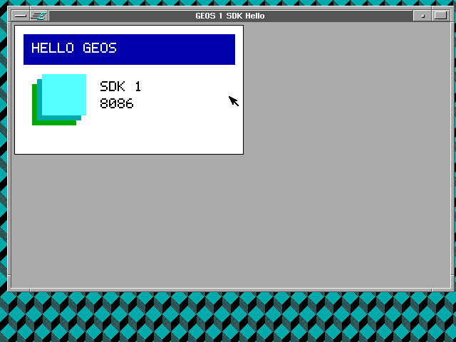
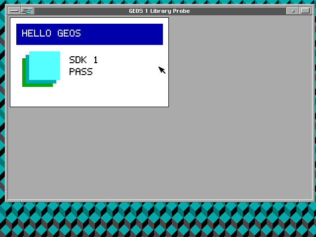

# Validierung — SDK 0.2.0, 14. November 2026

[English](VALIDATION.md) · [SDK](README.de.md)

Die Hostwerkzeuge des SDK verwenden jetzt Perl. Buildsteuerung, festgelegte Installer, Leser und Schreiber nativer Dateien, Anwendungsressourcen, Sprachserver, Editorpakete, Quellpakete und Tests benötigen kein Python. Für die Skripte genügen Perl 5.26+ und seine Kernmodule. Compiler und die im Einrichtungsleitfaden genannten externen Werkzeuge bleiben getrennte Abhängigkeiten.

## Diese Version

| Prüfung | Ergebnis | Nachweis |
|---|---|---|
| Perl-Regressionssuite | 719 Prüfungen in 12 Dateien unter Linux x86-64 bestanden | [Hosttests](validation/host-tests.json) |
| Neue Werkzeuginstallation aus zwischengespeicherten Archiven mit geprüften Hashes | Watcom, NASM, Esp und Glue bestanden | [Installation](validation/toolchain-integration.json) |
| Neubau aller fünf Beispiele | Bytegenau identisch mit den zuvor nativ getesteten Dateien | [Perl-Umstellung](validation/perl-port.json) |
| Tatsächlich verlinkte Assembler-, C- und gemischte Befehle | 139.440 Fälle im begrenzten Perl-Interpreter bestanden | [Assembler](validation/math-asm-execution.json), [C](validation/math-c-execution.json), [gemischt](validation/math-mixed-execution.json) |
| Auf dem Host kompilierter skalarer C-Quellcode | 196.608 Vergleiche bestanden | `tests/algorithms/algorithms.t` |
| VS-Code-Client mit tatsächlichem Perl-Serverprozess | Protokoll, Vertrauen, Lebenszyklus, UTF-16-Änderungen und Funktionen mit nachgebildeter VS-Code-API bestanden | [Client](validation/editor-client-smoke.json) |
| Syntaxdateien und reproduzierbare Editorpakete | Bestanden | [Editorressourcen](validation/multi-ide-assets.json) |
| Quell-ZIP und gesonderter Neubau | Abschließende Paketprüfung getrennt dokumentiert | [Release](validation/release-check.json) |

Testprüfungen und Befehlsausführungsfälle sind unterschiedliche Zählungen. Der Perl-Interpreter akzeptiert ausschließlich die geprüften Beispielbefehle und Adressierungsarten; andere werden abgewiesen. Er prüft verlinkten Code, Stack-/Registerverträge, getrennte SS/DS und die bekannte Relokation der festen Ressource im gemischten Beispiel. Er bildet weder DOS, GEOS-APIs, den nativen Loader, Hardwarezeiten noch beliebige 8086-Programme nach.

Die [Sprachservermessung](validation/lsp-host-measurement.json) umfasst einen Lauf auf einem modernen Host mit 10.002 Quellzeilen innerhalb eines Prozesses. IDE und Transport sind nicht enthalten; die Messung beschreibt weder GEOS-RAM noch die Leistung eines 8088.

## Nachweis nativer Ausführung

Die ursprüngliche Hello-Anwendung und die Bibliotheksprobe liefen zuvor in der gelieferten Ensemble-1.2-Installation unter DOSBox-X mit **8086-Kern und 640 KB konventionellem RAM**, VGA 640×480, Festplattenauslagerung und deaktiviertem XMS/EMS/UMB. Die BIOS-Probe bestätigte 640 KB. Die Fenstersteuerung von Hello funktionierte; die Bibliotheksprobe zeigte nach Aufrufen der Assembler-, C- und gemischten Bibliotheken PASS. Siehe den unveränderten [nativen Bericht](validation/native-ensemble12.json) und die [Zielidentitäten](validation/supplied-target-identity.json).

Bei der Perl-Umstellung wurde der interaktive GEOS-Lauf nicht wiederholt. Stattdessen erzeugte die neue Perl-Werkzeugkette alle fünf nativ getesteten Binärdateien bytegenau erneut. Damit bleibt deren vorhandener Nachweis erhalten; neu geänderte Programme werden dadurch nicht nativ zertifiziert.

| Datei | Bytes | SHA-256 |
|---|---:|---|
| `G1HELLO.GEO` | 1.668 | `5be45e9c4cb9991e84496a3c4994080b7e2cb974012948de6b2660534ebe3d8d` |
| `G1PROBE.GEO` | 1.938 | `754224f270310325738b74e538a621cca6cbcc09b69b105e6e6d57f4c4dbb828` |
| `G1MATH.GEO` | 354 | `412f1bdd923f5889f051fe7e31df88007b366a02fc41ec87fc75a67fa0dbc302` |
| `G1MATHC.GEO` | 370 | `ccc9fd0eaf4bb064d6fbb70ec6a5e5e7dfa12ec791c58286a76157ab7b2bb690` |
| `G1MIXED.GEO` | 436 | `ae54fc5fafd859d4e996375a48d9dbbe8457bbff7b09d48a73458df22eb19e11` |





Die Berichte unter `validation/history-0.1.0/` bewahren frühere Werkzeugnachweise einschließlich des vorherigen Interpreters und seiner Messungen. Sie sind historische Aufzeichnungen und keine aktuellen Installationsanweisungen.

## Grenzen und Wiederholung

Unterstützt bleibt eine experimentelle, dokumentierte Ensemble-1.2-API-Teilmenge: Kernel 622.3 und UI 693.0. Vollständige historische APIs, allgemeine GOC/UIC-Kompilierung, sämtliche C-Systemadapter, andere 1.x-Runtimes, physische 8086/8088-Hardware, native Compilerhosts unter Windows/macOS und die interaktive Installation in jeder IDE bleiben ungeprüft. Statische Datei-/Ressourcengrößen sind keine gemessenen nativen RAM-Spitzenwerte. Die Skriptumstellung begründet keine neue Aussage zu Zeitverhalten oder Speichermangel-Stresstests.

```sh
perl sdk.pl doctor --require-toolchain
perl sdk.pl check
perl sdk.pl test
perl tools/check_repository.pl
perl sdk.pl verify-target /pfad/zur/eigenen/GWSVGA
perl sdk.pl build --project examples/hello-asm --target-root /pfad/zur/eigenen/GWSVGA
```

Die Suite aktiviert echte C-Compiler- und Node-Clientprüfungen, wenn diese Werkzeuge verfügbar sind; fehlende optionale Werkzeuge erscheinen als übersprungene Tests. Für eigene Änderungen gelten der [native Leitfaden](docs/de/native-applications.md) und die [Bibliotheksprobe](examples/hello-libraries/README.de.md). Die Runtime ist nicht Bestandteil des öffentlichen SDK.
