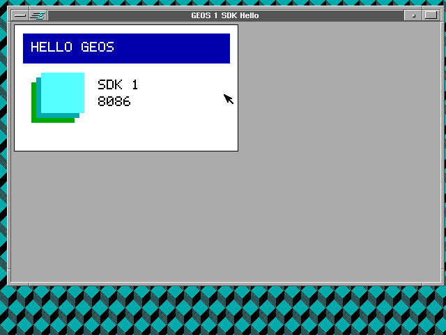
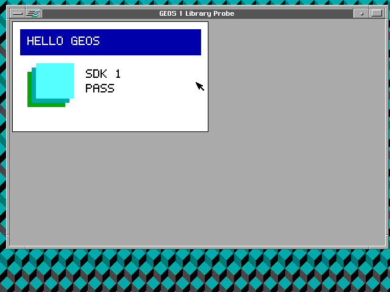

# Validation — SDK 0.2.0, 14 November 2026

[Deutsch](VALIDATION.de.md) · [SDK](README.md)

The SDK's host tooling is now Perl. Build orchestration, pinned installers, native-file readers/writers, application resource generation, language server, editor packaging, source packaging and tests run without Python. Perl 5.26+ and its core modules are sufficient for the scripting layer; compilers and the external tools listed in the setup guide remain separate dependencies.

## This release

| Check | Result | Evidence |
|---|---|---|
| Perl regression suite | 719 assertions in 12 files passed on Linux x86-64 | [Host tests](validation/host-tests.json) |
| Fresh pinned tool installation from cached, hash-verified archives | Watcom, NASM, Esp and Glue passed | [Installation](validation/toolchain-integration.json) |
| All five sample rebuilds | Byte-for-byte identical to the previously native-tested binaries | [Perl conversion](validation/perl-port.json) |
| Actual linked assembly, C and mixed instructions | 139,440 cases passed in the bounded Perl interpreter | [Assembly](validation/math-asm-execution.json), [C](validation/math-c-execution.json), [mixed](validation/math-mixed-execution.json) |
| Scalar C source compiled on the host | 196,608 comparisons passed | `tests/algorithms/algorithms.t` |
| VS Code client with a real Perl server subprocess | Protocol, trust, lifecycle, UTF-16 edits and features passed through a mocked VS Code API | [Client](validation/editor-client-smoke.json) |
| Syntax assets and deterministic editor packaging | Passed | [Assets](validation/multi-ide-assets.json) |
| Source ZIP and isolated rebuild | Final packaging checks recorded separately | [Release](validation/release-check.json) |

Assertions and instruction execution cases are different counts. The Perl instruction interpreter accepts only the audited sample instructions and addressing modes; it rejects everything else. It checks linked code, stack/register contracts, separate SS/DS and the mixed example's known fixed-resource relocation. It does not emulate DOS, GEOS APIs, the native loader, hardware timing or arbitrary 8086 programs.

The language-server [measurement](validation/lsp-host-measurement.json) is one modern-host, in-process run on 10,002 source lines. It excludes IDE and transport costs and says nothing about GEOS RAM or 8088 performance.

## Native execution evidence

The original Hello and library probe previously ran in the supplied Ensemble 1.2 installation on DOSBox-X's **8086 core with 640 KB conventional RAM**, VGA 640×480, disk swapping and XMS/EMS/UMB disabled. The guest BIOS memory probe confirmed 640 KB. Hello's window controls worked; the library probe displayed PASS after calls into the assembly, C and mixed libraries. See the unchanged [native record](validation/native-ensemble12.json) and [target identities](validation/supplied-target-identity.json).

This Perl conversion did not repeat the interactive GEOS run. Instead, the fresh Perl pipeline reproduced all five exact native-tested binaries. That preserves the evidence for these samples; it is not native certification of newly changed programs.

| File | Bytes | SHA-256 |
|---|---:|---|
| `G1HELLO.GEO` | 1,668 | `5be45e9c4cb9991e84496a3c4994080b7e2cb974012948de6b2660534ebe3d8d` |
| `G1PROBE.GEO` | 1,938 | `754224f270310325738b74e538a621cca6cbcc09b69b105e6e6d57f4c4dbb828` |
| `G1MATH.GEO` | 354 | `412f1bdd923f5889f051fe7e31df88007b366a02fc41ec87fc75a67fa0dbc302` |
| `G1MATHC.GEO` | 370 | `ccc9fd0eaf4bb064d6fbb70ec6a5e5e7dfa12ec791c58286a76157ab7b2bb690` |
| `G1MIXED.GEO` | 436 | `ae54fc5fafd859d4e996375a48d9dbbe8457bbff7b09d48a73458df22eb19e11` |





The `validation/history-0.1.0/` records preserve earlier tooling evidence, including the previous interpreter and its measurements. They are historical records, not current dependency instructions.

## Limits and repetition

Support remains an experimental, documented Ensemble 1.2 API subset: kernel 622.3 and UI 693.0. Complete historical APIs, general GOC/UIC compilation, full C system wrappers, other 1.x runtimes, physical 8086/8088 hardware, native Windows/macOS compiler hosts and interactive installation in every IDE remain unverified. Static file/resource sizes are not measured native peak RAM. No new timing or low-memory stress claim is made for the scripting conversion.

```sh
perl sdk.pl doctor --require-toolchain
perl sdk.pl check
perl sdk.pl test
perl tools/check_repository.pl
perl sdk.pl verify-target /path/to/owned/GWSVGA
perl sdk.pl build --project examples/hello-asm --target-root /path/to/owned/GWSVGA
```

The suite enables real C compiler and Node client checks when those tools are available; missing optional tools are reported as skips. Follow the [native tutorial](docs/en/native-applications.md) and [library probe guide](examples/hello-libraries/README.md) for testing your own changes. Runtime files remain outside the public SDK.
