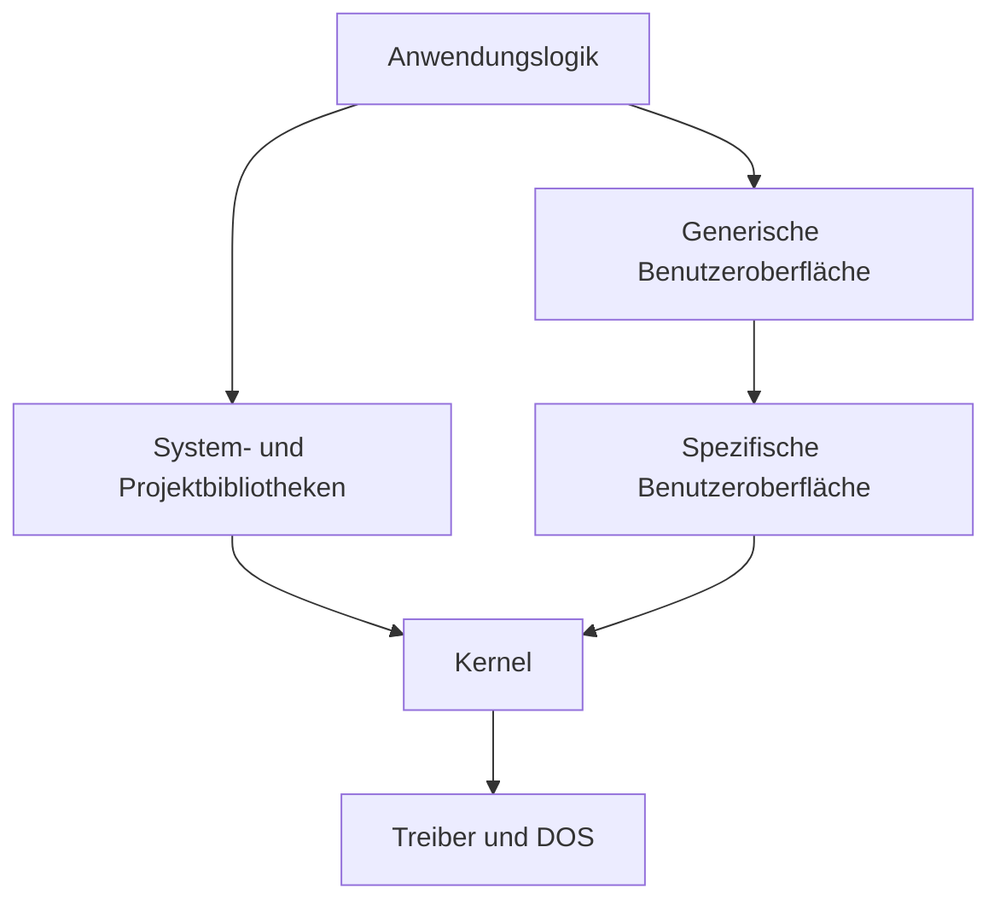

# Architektur einer GEOS-Anwendung

[Handbuch](README.md) · [English](../en/architecture.md)

GEOS-Anwendungen arbeiten mit Ressourcen, dynamisch geladenen Bibliotheken und einer objektorientierten, nachrichtenbasierten Oberfläche. Ein Programm ist deshalb mehr als ein zusammenhängender Codeblock mit einem DOS-Einstiegspunkt.

Die [Architekturübersicht](https://bluewaysw.github.io/pcgeos/Concepts/carch.html) der öffentlichen Dokumentation hilft beim Verständnis dieser Aufteilung. Sie beschreibt eine spätere SDK-Generation; konkrete Strukturdefinitionen und Aufrufverträge müssen zusätzlich für 1.x belegt sein.

## Die beteiligten Schichten

Die Trennung ist praktisch wichtig. Eine Anwendung kann beispielsweise eine Funktion wie „Auswahl bestätigen“ beschreiben, ohne selbst jedes Aussehen eines Knopfes zu zeichnen. Die spezifische UI setzt die generischen Anforderungen um. Systemdienste und Treiber kapseln wiederum Speicher-, Geräte- und Dateisystemdetails.

## Geodes und Ressourcen

Ein Geode enthält die vom Zielsystem benötigten Modul- und Ressourceninformationen. Je nach Modulart gehören Code, feste Daten, Objektblöcke, Zeichenketten und grafische Daten dazu. Der Loader muss außerdem Abhängigkeiten und Relokationen auflösen können.

Ressourcen sind ein Entwurfswerkzeug für knappen Speicher. Teilen Sie sie nach Lebensdauer und Aufrufhäufigkeit auf:

- Häufig benutzter Code sollte nicht fortwährend zusammen mit großen, selten benötigten Daten geladen werden müssen.
- Ein seltener Dialog kann getrennt von der Hauptansicht gehalten werden.
- Große eingebettete Bilder und Hilfstexte brauchen nicht zwangsläufig gleichzeitig mit dem Such- oder Berechnungskern resident zu sein.
- Gemeinsame, unveränderliche Daten haben andere Eigentumsregeln als pro Fenster veränderliche Zustände.

Die exakten Ressourcenattribute und deren Bedeutung kommen aus dem Zielprofil. „Verwerfbar“, „beweglich“ und „gemeinsam genutzt“ dürfen nicht ohne Kenntnis der Lebensdauer gewählt werden. Ein gespeicherter Rohzeiger wird nicht dadurch sicher, dass die betreffende Ressource früher einmal geladen war.

## Handles statt dauerhafter Adressen

Ein Handle identifiziert einen verwalteten Speicherblock. Seine aktuelle Segmentadresse kann sich von seiner stabileren Identität unterscheiden. Ein typischer Zugriff erfolgt deshalb in einer begrenzten Folge: passenden Block sperren, gültige Adresse beziehen, lokal arbeiten und die Sperre wieder lösen.

Speichern Sie über einen möglichen Verschiebe- oder Entladepunkt hinweg nur die vom betreffenden Dienst dafür vorgesehenen Identifikatoren. Ein Blockhandle, ein Chunk innerhalb eines lokalen Speicherblocks und eine vollständige Objektreferenz sind verschiedene Dinge. Ein Zahlenwert allein zeigt nicht, welche Bedeutung er hat.

## Objekte und Nachrichten

Objekte besitzen Zustände und verarbeiten Nachrichten. Eine Nachricht kann unmittelbar bearbeitet oder in eine Warteschlange gestellt werden. Daraus folgen zwei unterschiedliche Verträge:

| Aufrufart | Was der Aufrufer wissen muss |
|---|---|
| Synchroner Aufruf | Rückgabewerte, zulässige Wiedereintrittspunkte, Sperrreihenfolge und mögliche Zustandsänderungen |
| Eingereihte Nachricht | Lebensdauer der Parameter, Zustellung nach Rückkehr des Aufrufers, Reihenfolge und mögliche Zusammenfassung |

Ein Zeiger auf einen lokalen Stapelpuffer ist daher kein brauchbarer Parameter für eine später bearbeitete Nachricht. Ebenso kann ein synchroner Aufruf in einen anderen Objektblock den aktuellen Zustand verändern, bevor die ursprüngliche Methode fortgesetzt wird.

Legen Sie für jede eigene Nachricht fest, welche Parameter sie akzeptiert, ob diese kopiert werden, wem übergebener Speicher gehört und wann er freigegeben wird. Halten Sie die Dokumentation an der Nachrichtendefinition und am Adaptercode zusammen.

## Threads, UI und lange Arbeiten

Lange Berechnungen gehören nicht als ununterbrochene Schleife in einen UI-Ereignishandler. Teilen Sie die Arbeit in überschaubare Schritte auf oder nutzen Sie einen vom Ziel tatsächlich unterstützten Arbeits- und Nachrichtenmechanismus. Die konkrete Thread-API ist Teil der Ziel-ABI.

Vermeiden Sie fremde Objektsperren während einer Zeichenoperation. Ein kleiner kosmetischer Zugriff kann sonst eine Sperrreihenfolge über Anwendung und UI hinweg erzeugen. Der Bildschirmcode sollte aus lokal verfügbaren Zuständen zeichnen und keine versteckte Objektkommunikation benötigen, um ein paar Pixel zu bestimmen.

## Der erste Architekturentwurf

Erstellen Sie vor dem Code eine kurze Tabelle:

| Bestandteil | Besitzer | Lebensdauer | Zugriff |
|---|---|---|---|
| Dokumentmodell | Dokument beziehungsweise Anwendung | Bis zum Schließen des Dokuments | Über definierte Nachrichten oder Adapter |
| Rechenkern | Berechnungsauftrag | Ein Auftrag oder ein Schritt | Kleine, dokumentierte Ein-/Ausgaben |
| Oberflächenzustand | Fenster/Objekt | Solange das Objekt besteht | Im zugehörigen Ereigniskontext |
| Vorschau | Ansicht | Neu erzeugbar | Aus Modellzustand ableiten |
| Permanente Daten | Dateiformat | Über Programmstarts hinweg | Explizit serialisieren |

Diese Trennung erleichtert Tests und Rückportierungen. Ein unveränderter Rechenkern kann auf dem Host getestet werden, während ein kleiner 1.x-Adapter die tatsächlich benötigten Betriebssystemdienste bereitstellt.

