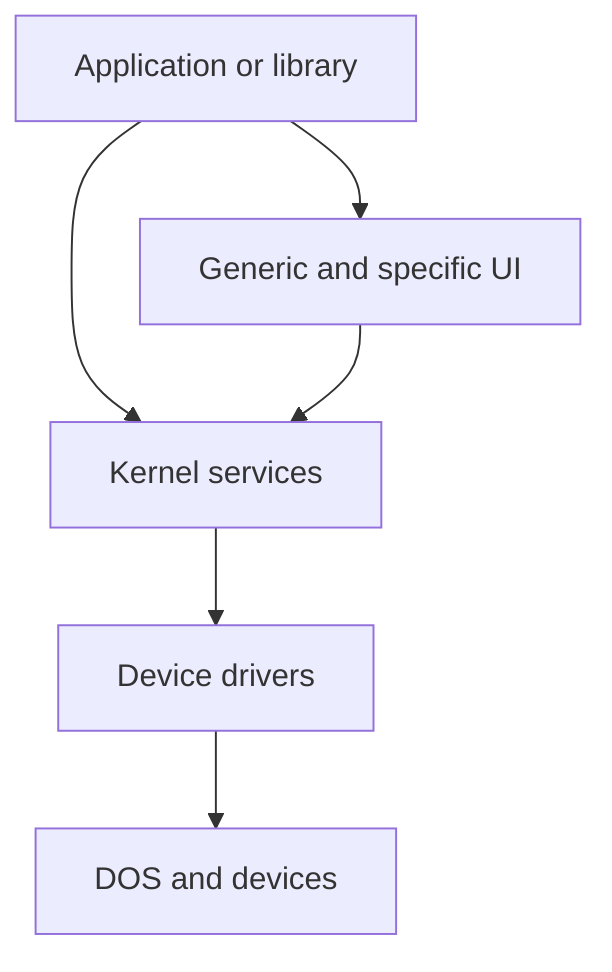

# Architecture: modules, resources, objects and execution

[Handbook](README.md) · [Deutsch](../de/architecture.md)

GEOS development is easiest when the program's identities are kept separate from its current memory addresses. Plan the module boundary, the resource boundary and the object/message boundary before choosing data layouts.

## Conceptual layers

The diagram shows logical responsibilities, not an ABI specification. A small calculation library may need none of the UI or device paths. Any concrete call across these boundaries still needs the selected target's verified interface.

## The module is a geode

Applications, libraries and drivers have different roles, even when they use related native file machinery. The loader needs a module identity, a resource description and enough linkage information to resolve dependencies and exports. A filename alone supplies none of that.

An application also needs an event-driven lifecycle: startup, UI creation, actions, close, possible document handling and shutdown. A calculation library needs a documented export contract and caller. A device driver has system-specific contracts and should not be used as the first sample project.

Keep the permanent module name distinct from a translated user-visible title. Keep protocol identity distinct from a source revision or a marketing version. Changing an ABI without changing the relevant protocol is a compatibility defect.

## Resources are a design tool

A resource groups code or data with loading, sharing and lifetime properties. Separate frequently used code from large optional tables or dialogs. Group code by likely use rather than placing everything in one permanently resident segment.

Questions to ask for each resource:

- Who owns it and who can modify it?
- Must it be resident, or can the loader bring it in when needed?
- Can another application share it safely?
- Can it be discarded and reconstructed from its file or source state?
- Does it contain pointers that need relocation?
- Does it contain object or local-memory structures rather than flat bytes?
- What calls might occur while it is locked?

Use the actual 1.x resource flags and native format from your profile. Later definitions can add fields or change assumptions. A resource writer must preserve unrelated flags, tables, padding and relocation semantics unless it intentionally owns their replacement.

## An object pointer is an identity

An object is an instance of a class, with instance data and message handlers. Its object pointer identifies an object through a block/chunk mechanism; it is not a directly dereferenceable C address. Class inheritance describes behavior and data layout, but inherited field offsets are versioned details.

Prefer sending a documented message to accessing another object's private data. Direct reads tie the program to that implementation's layout and locking rules. A copied or instantiated object may receive different local chunk handles from its template; fixed template handles are not a general runtime classification mechanism.

The official [architecture chapter](https://bluewaysw.github.io/pcgeos/Concepts/carch.html) gives a later-SDK overview of geodes, generic UI and message-driven objects. Treat its specific classes and examples as versioned references.

## Messages and queues

A message is an operation or notification with a defined argument/result contract. Distinguish a synchronous call, which may return a result, from a queued operation, which runs later. A pointer into temporary stack storage cannot outlive the call that owns it.

For a queued message, choose data whose lifetime reaches the recipient: copied values, a suitable handle with explicit ownership transfer, or another representation allowed by the exact API. Specify who releases it if the receiver exits or the operation fails.

Do not assume that a queued operation has completed when the sender resumes. A paint request, resize, document update or task activation can require multiple message turns. Native tests must wait for an observable state rather than taking a screenshot immediately after a click and treating an unfinished repaint as lost data.

## Threads and reentrancy

The system schedules threads; an event handler should perform bounded work and return. A busy loop in the UI path can make the application feel hung even when other threads remain alive.

Separate ownership of mutable application state. A worker can calculate into its own storage and send a result notification. The UI should consume the result through a clear handoff. If both threads can access a block, define its synchronization and destruction rules.

Every synchronous call can create a reentrancy boundary. A seemingly simple operation may invoke another object, allocate storage, trigger a callback or wait for another thread. Reacquire movable pointers afterward. Avoid holding a private lock across a call that can reach code with an incompatible lock order.

## Generic UI and specific UI

Generic objects describe user-facing functionality; a specific UI supplies a concrete presentation. This is valuable for backporting: use available generic controls instead of baking one specific UI's private window layout into an application.

Hints are requests, not universal guarantees. Functionality and appearance must be tested on the actual specific UI. If a program must remain usable under a different window size, language or font, let the supported geometry mechanism do its work and recompute custom drawing from current bounds.

## Lifecycle and teardown

List every owned item: memory blocks, file handles, timers, worker state, graphics objects, imported library references and queued notifications. For each, define creation, ownership transfer and destruction.

A good close path tolerates partial initialization. It cancels or drains work according to the native contracts, prevents late notifications from accessing destroyed objects, and preserves the system's normal save/cancel behavior. It should not replace a document-close action with an unconditional process exit.

## Practical project structure

Keep business logic independent of native UI glue where possible. Put ABI declarations and adapters in a small, reviewable area. Keep localizable text out of algorithms. Keep testable calculations separate from resources that only the target loader can instantiate.

The initial library examples demonstrate a deliberately narrow module boundary. Building an application adds the verified object/UI and lifecycle layer; it does not require rewriting the algorithm in assembly.
